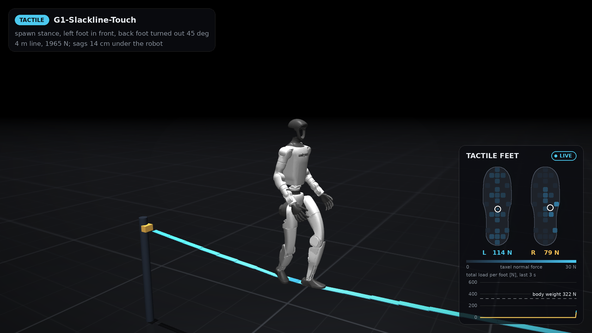

# Slackline

The G1 stands in a tandem stance on a tensioned slackline and, when the
joystick asks, walks along it. Plain PPO (`tasks/slackline`,
`common/slackline`), one paired comparison:

| Task id | Actor sees | Actor dim |
|---|---|---|
| `G1-Slackline-Blind` | IMU, joints, previous action, forward command | 94 |
| `G1-Slackline-Touch` | same, plus the tactile touch features (31 per foot) | 156 |

Same env, critic (358), reward, events and PPO settings; only the actor's
inputs differ (`tests/test_slackline.py` checks the fingerprints). Actor and PPO: the
standard LSTM settings every task shares (`sendg1/common/ppo.py`), 20k
iterations; a GRU until 2026-11-25.
Untrained so far.

## The line (`common/slackline/model.py`)

A 4 m span, webbing 5 cm wide (narrower than the 7 cm sole), anchors 1.0 m up,
tension 1.5 kN nominal, randomised 1-2 kN per world. Its stiffness comes from
the tension, as on a real line: the span is cut into 20 cm pieces, each free to
move sideways and up/down and to roll, and neighbours (and the end pieces and
their anchors) are joined by springs of stiffness `T / dx`. That is exactly a
taut string: a point load `F` at `x` sinks it by `F x (L - x) / (T L)`. With the
G1 on it the line sags ~20-30 cm and sways sideways with a ~1.2 s period. Each
piece is also pitched and yawed to the local slope by equality constraints, so
the webbing is a smooth chain rather than a staircase. Roll is nearly free
(a 5 cm strip under tension barely resists twist): the soles have to keep the
force through the line or it rolls out from under them. That twist stiffness is
the tension's, `T w^2 / 12` per metre (the strip's edges stretch when it
twists; the webbing's own torsional rigidity, `G w t^3 / 3` for 1-2 mm
polyester, is ~1 % of it): ~0.3 N m/rad to twist the free line at mid-span,
0.22-0.41 over the 1-2 kN tension range, which scales it with the string.

Numerics, learnt the hard way at the 5 ms step:

- Free nodes coupled by damped tendons went unstable at any damping; the fix is
  armature on each slide (0.3 kg, ~6 kg over the span against the robot's 35)
  plus relative damping on the tendons. The fundamental mode stays lightly damped.
- A 4 mm contact box lets a loaded foot sink through; the contact box is 8 cm
  deep and near-invisible, with a 4 mm visual strip on top. At 2 cm a loaded
  sole sank past its mid-plane and MuJoCo resolved the contact through the
  bottom face (normals flipped, the line pulled the foot down). Alpha 0 would
  hide it from the taxel rays: mujoco_warp's raycast skips alpha-0 geoms.

Video of the line alone and of the robot on it without a policy:
`uv run python scripts/slackline_video.py` (`results/slackline/line_demo.mp4`).

## Line models (`sm.SURFACES`, `sm.CONTACTS`)

The same node chain (so the same sag and sway) under four contact surfaces;
`G1-SlacklineFlex-*` and `G1-SlacklineCable-*` register the flex ones.
`scripts/slackline_surfaces.py --stats --media` measures them with the G1
holding the stance on the free line (256 spawns, first 0.3 s; boxes overlap
their neighbours by 2 cm, `SEGMENT_OVERLAP`):

| Model | Soles sink (mean / deepest) | Contacts pushing up | Sole load read | Taxel rays hit |
|---|---|---|---|---|
| boxes, default contact (`G1-Slackline-*`) | 10.4 / 24.6 mm | 16 % | -0.17 body weight | 44 % |
| boxes, stiff contact | 1.7 / 3.4 mm | 95 % | 0.97 | 54 % |
| flex ribbon (`G1-SlacklineFlex-*`) | 1.8 / 3.2 mm | 78 % | 0.88 | 48 % |
| flex cable, round rope (`G1-SlacklineCable-*`) | 11.6 / 20.6 mm | 3 % | 1.05 | 12 % |

What fixes the sensing is the contact, not the surface. MuJoCo scales a soft
contact's stiffness by the effective mass at it, and a 20 cm piece of webbing
pivoting on its pitch/yaw hinges weighs almost nothing, so with the defaults the
soles sink 1-2.5 cm, mostly into the pieces' sides and ends. `stiff` gives the
line `solref 0.01`, `solimp 0.95/0.99` (priority over the sole) and 20x the
pitch/yaw armature; roll is untouched. The ribbon is seamless but needs
workarounds in mujoco_warp 3.11 / mjlab 1.6: contact sensors cannot match a flex
(they match against anything; `nonfoot_on_line` reads the contact list), the BVH
raycast reads out of bounds with any flex in the model (the taxel rays use the
plain geom kernel and hit thin non-colliding boxes under the ribbon), and flex
vertex offsets are one per model, so its levels keep 5 cm width. The round
cable gives a flat sole nothing to stand on.

## Curriculum (`common/slackline/mdp.py::LEVELS`, `line_levels`)

Per env, from a stiff, wide plank to the real line. A level sets the webbing's
width and two helper springs per 20 cm piece, against the world: one on its
sideways/vertical motion (a shorter, tauter line) and one on its roll (webbing
that will not twist). Tension alone cannot carry it: above ~2.4 kN the string's
springs outrun the 5 ms step.

| Level | Width | Helper, sway/sag (N/m per piece) | Helper, roll (N m/rad per piece) | Sag under the G1 |
|---|---|---|---|---|
| 0 | 20 cm | 8000 | 400 | ~0 cm |
| 1 | 14 cm | 8000 | 400 | ~0 cm |
| 2 | 10 cm | 4000 | 150 | ~0 cm |
| 3 | 7 cm | 2000 | 50 | ~0 cm |
| 4 | 5 cm | 800 | 15 | ~3 cm |
| 5 | 5 cm | 250 | 4 | ~8 cm |
| 6 | 5 cm | 0 | 0 | ~18 cm (the free line) |

Promote on success (survived the episode; walking, also covered 70 % of the
commanded distance or reached the end margin), demote on an early termination.
20 % of resets replay a random easier level without moving the env's own level
(the beam's lesson against forgetting). Standing commands fall from 70 % at mean
level 0 to 40 % at the top. The critic sees the level (`line_level`); the
actors do not. The reward is the same on every level. Play / evaluation configs
run at the top level (`apply_line_level(fixed_level=...)`).

The width steps (20 -> 5 cm) come first and are the ones to watch: the beam task
never got past 10 cm.

### Balance tasks: continuous difficulty (`line_difficulty`)

`G1-SlacklineBalance-{Touch,Blind}` stand only, on 5 cm webbing throughout, and
replace the levels with a per-env difficulty in [0, 1]
(`apply_line_level(continuous=True)`). It slides through `BALANCE_SPRINGS`,
eleven helper settings evenly spaced: the levels' (at 0, .1, .2, .4, .6, 1)
plus steps in the soft end, geometric between neighbours and linear into the
free line's zero. Roll helper per piece by tenth: 400, 150, 50, 25, 15, 8, 4,
1.5, 0.5, 0.15, 0 N m/rad. The old table jumped from level 5's 4 N m/rad per
piece (~75 over the span) straight to the free line's ~0.3. Why: under
+1/-1 an env climbs only by winning more than half its episodes, and training
rollouts explore (action std 0.42) while videos do not. After 20k iterations
half the envs were still on level 0, none ever reached a swaying line (level
4+), and the policy fell off the free line within ~2 s.

- An episode succeeds if it lasted 80 % of the time limit (`SURVIVE_FRAC`).
- Episodes on the env's own difficulty fill a window of 8; with at least 4 in
  it, a success rate of 50 % or more raises the difficulty by 0.05, below 25 %
  lowers it, and either clears the window. (At 60 / 30 % the first cluster
  run parked at ~48 % success: training rollouts explore.)
- 70 % of resets run on the env's own difficulty, 15 % on an easier one, 10 %
  on a harder one and 5 % on the free line, from the start; these probes do
  not count towards the window. The critic sees the episode's difficulty.

## Stance and spawn

`scripts/slackline_stance.py` solves the stance slackliners teach: front foot
straight along the line, back foot turned out 45°, CoM over the middle, feet
28 cm apart, the ankle-linkage braces clear of the webbing. It writes
`common/slackline/stance.py` for both mirror images. Each reset faces the robot
a random way along the line, a random foot in front, 0.8 m after the first
anchor to just past mid-span, with the line already sagged under its weight.
Actions stay offsets from the default (parallel-feet) pose, so the policy has
to learn to hold the stance; held open-loop the robot topples in ~0.4 s.

## Reward (`tasks/slackline/env_cfg.py::build_rewards`)

Survival (alive, -100 on an early end); forward progress along the line with
the beam's slack, or standing still; walking, a reward per alternating step of
new ground (`step_progress`, the beam's `feet_in_line` without the gap factor;
it replaced `feet_air_time`, which tapping farms); the CoM over the webbing beneath it and the
line not swinging (from the cylinder's `cylinder_still`); soles centred on the
webbing, front foot straight and back foot at 45° (by position along the line,
so the roles swap with each step), soles flat, upright, facing along the line;
costs for a foot lifted while standing, slip, stamping, and the pedalo's elbow
and wrist windows with free shoulders. Ends on a foot on the floor, any non-foot
body on the line (the ankle-linkage braces excepted) or the floor, base under
0.55 m over the line, or 45° tilt.

## Open

- Balance, Touch, one seed (2026-10-29, local, levels): 20k iterations
  (5k + 15k resumed), episodes 571 of 1000 steps, mean level 0.72 (50 % on
  level 0, none above 3). Videos: stands 20 s on the stiff line, falls off
  the free line in 1.4-2.8 s. Continued from that checkpoint on the cluster
  with `line_difficulty` (run `balance_touch_s0_difficulty`, to 30k; first
  version: levels 1-6 evenly spaced, 60 / 30 %): mean difficulty 0.16 (peak
  0.19), none past 0.4, ~48 % success on the envs' own difficulty. Videos at
  29999: stiff line 3 of 3 x 20 s, difficulty 0.4 1 of 3, free line falls in
  1.5-1.9 s. Action std flat at 0.41 from 20k to 30k (entropy 0.005).

- First 20k-iteration pair (2026-10-21, one seed) is void: it ran with the
  2 cm, alpha-0 contact box, so the Touch actor's taxel rays never saw the
  line and contact forces had mixed signs. Both stayed on level 0 (mean level
  0.07 / 0.06), episodes 422 / 280 of 1000 steps, no walking. Video:
  `scripts/slackline_policy_video.py`.
- Before that, a 300-iteration sanity run (Blind, 4096 envs, one seed):
  mean episode length fell from 28 to 12 steps, then climbed to 53 (~1 s of
  20 s); every env still on level 0. Held open-loop, the stance topples in
  ~0.3 s on every level: the policy has to balance from the start.
- The numbers (span, height, tension, webbing) are chosen, not measured.
