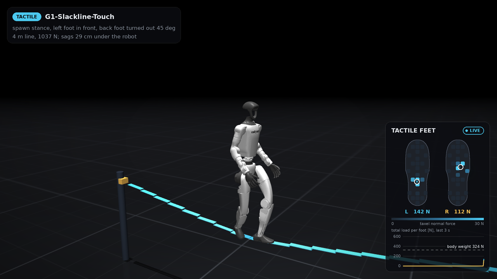

# Slackline

The G1 stands in a tandem stance on a tensioned slackline and, when the
joystick asks, walks along it. Plain PPO (`tasks/slackline`,
`common/slackline`), one paired comparison:

| Task id | Actor sees | Actor dim |
|---|---|---|
| `G1-Slackline-Blind` | IMU, joints, previous action, forward command | 94 |
| `G1-Slackline-Touch` | same, plus the tactile touch features (31 per foot) | 156 |

Same env, critic (358), reward, events and PPO settings; only the actor's
inputs differ (`tests/test_slackline.py` checks the fingerprints). Actor: rsl_rl's
plain GRU `RNNModel` with the beam's sizes and PPO settings, 20k iterations.
Untrained so far.

## The line (`common/slackline/model.py`)

A 4 m span, webbing 5 cm wide (narrower than the 7 cm sole), anchors 1.0 m up,
tension 1.5 kN nominal, randomised 1-2 kN per world. Its stiffness comes from
the tension, as on a real line: the span is cut into 20 cm pieces, each free to
move sideways and up/down and to roll, and neighbours (and the end pieces and
their anchors) are joined by springs of stiffness `T / dx`. That is exactly a
taut string: a point load `F` at `x` sinks it by `F x (L - x) / (T L)`. With the
G1 on it the line sags ~20-30 cm and sways sideways with a ~1.2 s period. Each
piece is also pitched and yawed to the local slope by equality constraints, so
the webbing is a smooth chain rather than a staircase. Roll is nearly free
(a 5 cm strip under tension barely resists twist): the soles have to keep the
force through the line or it rolls out from under them.

Numerics, learnt the hard way at the 5 ms step:

- Free nodes coupled by damped tendons went unstable at any damping; the fix is
  armature on each slide (0.3 kg, ~6 kg over the span against the robot's 35)
  plus relative damping on the tendons. The fundamental mode stays lightly damped.
- A 4 mm contact box lets a loaded foot sink through; the contact box is 2 cm
  deep and invisible, with a 4 mm visual strip on top.

Video of the line alone and of the robot on it without a policy:
`uv run python scripts/slackline_video.py` (`results/slackline/line_demo.mp4`).

## Curriculum (`common/slackline/mdp.py::LEVELS`, `line_levels`)

Per env, from a stiff, wide plank to the real line. A level sets the webbing's
width and two helper springs per 20 cm piece, against the world: one on its
sideways/vertical motion (a shorter, tauter line) and one on its roll (webbing
that will not twist). Tension alone cannot carry it: above ~2.4 kN the string's
springs outrun the 5 ms step.

| Level | Width | Helper, sway/sag (N/m per piece) | Helper, roll (N m/rad per piece) | Sag under the G1 |
|---|---|---|---|---|
| 0 | 20 cm | 8000 | 400 | ~0 cm |
| 1 | 14 cm | 8000 | 400 | ~0 cm |
| 2 | 10 cm | 4000 | 150 | ~0 cm |
| 3 | 7 cm | 2000 | 50 | ~0 cm |
| 4 | 5 cm | 800 | 15 | ~3 cm |
| 5 | 5 cm | 250 | 4 | ~8 cm |
| 6 | 5 cm | 0 | 0 | ~18 cm (the free line) |

Promote on success (survived the episode; walking, also covered 70 % of the
commanded distance or reached the end margin), demote on an early termination.
20 % of resets replay a random easier level without moving the env's own level
(the beam's lesson against forgetting). Standing commands fall from 70 % at mean
level 0 to 40 % at the top. The critic sees the level (`line_level`); the
actors do not. The reward is the same on every level. Play / evaluation configs
run at the top level (`apply_line_level(fixed_level=...)`).

The width steps (20 -> 5 cm) come first and are the ones to watch: the beam task
never got past 10 cm.

## Stance and spawn

`scripts/slackline_stance.py` solves the stance slackliners teach: front foot
straight along the line, back foot turned out 45°, CoM over the middle, feet
28 cm apart, the ankle-linkage braces clear of the webbing. It writes
`common/slackline/stance.py` for both mirror images. Each reset faces the robot
a random way along the line, a random foot in front, 0.8 m after the first
anchor to just past mid-span, with the line already sagged under its weight.
Actions stay offsets from the default (parallel-feet) pose, so the policy has
to learn to hold the stance; held open-loop the robot topples in ~0.4 s.

## Reward (`tasks/slackline/env_cfg.py::build_rewards`)

Survival (alive, -100 on an early end); forward progress along the line with
the beam's slack, or standing still; walking, a reward per alternating step of
new ground (`step_progress`, the beam's `feet_in_line` without the gap factor;
it replaced `feet_air_time`, which tapping farms); the CoM over the webbing beneath it and the
line not swinging (from the cylinder's `cylinder_still`); soles centred on the
webbing, front foot straight and back foot at 45° (by position along the line,
so the roles swap with each step), soles flat, upright, facing along the line;
costs for a foot lifted while standing, slip, stamping, and the pedalo's elbow
and wrist windows with free shoulders. Ends on a foot on the floor, any non-foot
body on the line (the ankle-linkage braces excepted) or the floor, base under
0.55 m over the line, or 45° tilt.

## Open

- Untrained beyond a 300-iteration sanity run (Blind, 4096 envs, one seed):
  mean episode length fell from 28 to 12 steps, then climbed to 53 (~1 s of
  20 s); every env still on level 0. Held open-loop, the stance topples in
  ~0.3 s on every level: the policy has to balance from the start.
- The numbers (span, height, tension, webbing) are chosen, not measured.
